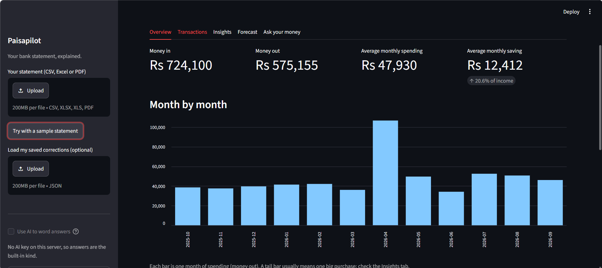
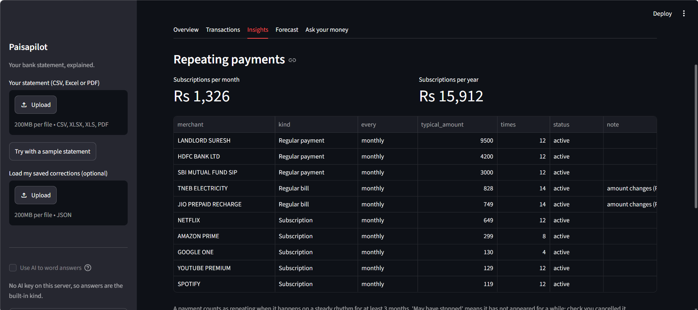
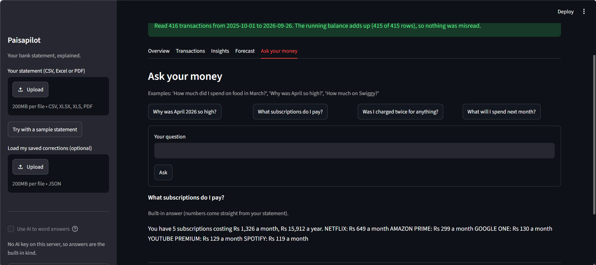
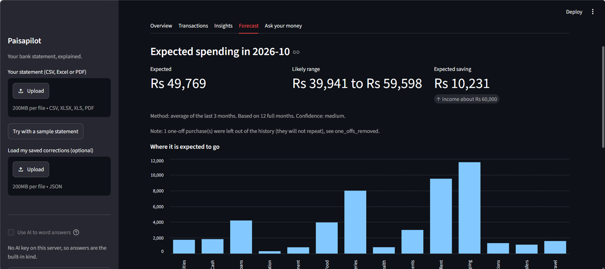

# Paisapilot: a personal finance copilot for Indian bank statements

Upload a bank statement (CSV, Excel or PDF). Paisapilot sorts every transaction into a category, finds subscriptions,
double charges and unusually large payments, forecasts next month's spending, and answers questions about your money in
plain English, with every number checked against your statement.

**Live demo:** YOUR-APP-URL (uses a fictional sample statement; please do not upload your real statement to a public demo)



## What it does

| | |
|---|---|
| **Reads messy statements** | CSV, Excel and PDF. Finds the header row, recognises columns by name, handles Indian number formats (1,23,456.78), several date styles, newest-first statements, and one signed Amount column or separate Debit/Credit columns. A running-balance check tells you whether every row was read correctly. |
| **Understands UPI narrations** | Turns `UPI/DR/412345678901/SWIGGY/yesb/swiggy@yesb/UPI` into `SWIGGY`, and records how the money moved (UPI, card, ATM, NEFT). |
| **Categorises with a reason** | Your corrections, then keyword rules, then a small ML model (TF-IDF + logistic regression), otherwise "Uncategorised". Every row shows why it has its category. Fix a merchant once and it applies everywhere. |
| **Finds what matters** | Subscriptions and their yearly cost, payments that look stopped, price rises, same-day double charges, unusually large payments, and savings per month. Each finding comes with a plain-English reason. |
| **Forecasts, then grades itself** | Predicts next month's spending with a range, after testing four simple methods on months it already knows. |
| **Answers questions** | "Why was April so high?" Code computes the numbers; an AI only words the answer; code then verifies every amount and percentage. If the AI is unavailable or wrong, a built-in answer is shown. |



## How the AI is kept honest

1. **Code computes every number** (`facts.py`): totals, months, categories, subscriptions, forecast.
2. **The AI only writes the answer** (`ask.py`), from a short list of facts chosen for the question. It is told never to calculate.
3. **Code checks the answer.** Every amount and percentage in it must exist in the facts. If one does not, the AI gets one chance to rewrite; if it still fails, the built-in answer is shown instead.
4. **No key, no internet, quota used up?** The built-in, rule-based answer still works, and its numbers are right by construction.
5. **Privacy.** Only computed totals are sent, with names of people, landlords and employers hidden. Raw bank lines, reference numbers and balances are never sent.



## Honest results

These are the numbers from the project's own reports, including the unflattering ones.

- **Categoriser on the fictional sample:** 100% right. This number is not meaningful: the sample and the rules were written together. It only shows the pipeline works.
- **Categoriser, ML model alone, on merchants it has never seen:** 23.8% right overall, and right 78% of the time when it chose to answer. The model is weak on its own. Its job is to learn from your corrections, and it is deliberately quiet when unsure.
- **Forecast:** on the sample, typical miss 11.8%, against 16.2% for the plain rule "same as last month". A modest improvement, and sample spending is random month to month.
- **Not yet measured:** accuracy on real bank statements across many banks. Bank formats vary, and a statement that fails to read gives a plain-English message instead of wrong numbers.



## Tests

About 245 automated checks across 7 test files, run with one command:

```
python check_all.py
```

They cover reading every file type and layout, number and date oddities, bad and corrupt files, categorisation, each insight with hand-made cases (a price rise, a stopped subscription, two cheap identical purchases that are *not* a double charge), the forecast on steady, rising and short histories, answer checking with a pretend AI (correct answers, wrong numbers, retries, no key, API errors, call limits), what is and is not sent to the AI, and the whole pipeline from file to answer.

## Run it yourself

```
pip install -r requirements.txt
streamlit run app.py
```

For the AI answers, set a free key in the same terminal first (never commit a key):

```
set GEMINI_API_KEY=your_key_here        (Windows)
export GEMINI_API_KEY=your_key_here     (Mac/Linux)
```

or `GROQ_API_KEY`. Without a key, everything works with built-in answers. To run the tests: `pip install -r requirements-dev.txt`, then `python check_all.py`.

Try it without the web app:

```
python day1.py sample        # read a fictional statement
python day3.py               # subscriptions, double charges, unusual payments
python day4.py               # next month's forecast and its backtest
python day5.py --no-ai       # ask questions in the terminal
python day1.py my_statement.csv      # your own file (keep it private)
```

## Project layout

| File | Job |
|---|---|
| `statement.py` | Reads CSV / Excel / PDF into a clean table and checks the running balance |
| `merchants.py` | Narration to merchant, text and channel |
| `categoriser.py` | Corrections, rules, ML model, "Uncategorised" |
| `insights.py` | Repeating payments, double charges, unusual payments, monthly summary |
| `forecast.py` | Next month's spending, with a backtest |
| `facts.py`, `ask.py`, `llm.py` | Facts by code, AI wording, number checking, Gemini/Groq client |
| `appcore.py`, `app.py` | Logic behind the page, and the Streamlit page itself |
| `generate_sample.py` | A realistic fictional year of transactions with an answer key |
| `test_*.py`, `check_all.py` | Tests and one command to run them all |

## Privacy

- Your statement is read in memory during your visit and is not saved.
- Never commit a real statement. `.gitignore` blocks PDFs and files named `my_statement*` or `real_*`.
- For your own real statement, run the app on your own computer rather than on a public demo.
- This tool explains your own statement. It is not financial, tax or investment advice.

## Limitations and next steps

- Rules are tuned for Indian UPI, NEFT, IMPS and card narrations. Other countries' formats would need new rules.
- Only monthly and fixed-amount weekly rhythms are detected; yearly payments need more history than most statements hold.
- Forecasts are statistical guesses from past months, not budgets.
- Next: test on more banks' real exports, add a budget-limits view, and export a monthly summary.
